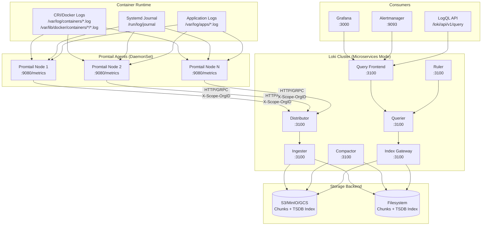

# Promtail Scraping Pipelines & Loki Production Architecture

## Architecture Overview



**Port Allocation Reference**
| Component | Port | Protocol | Purpose |
|-----------|------|----------|---------|
| Promtail | 9080 | HTTP | `/metrics`, `/ready`, `/config` |
| Loki Distributor | 3100 | HTTP/gRPC | Write path ingestion |
| Loki Ingester | 3100 | HTTP/gRPC | In-memory buffering, replication |
| Loki Querier | 3100 | HTTP/gRPC | Query execution |
| Loki Query Frontend | 3100 | HTTP/gRPC | Query splitting, caching |
| Loki Compactor | 3100 | HTTP/gRPC | TSDB compaction, retention |
| Loki Ruler | 3100 | HTTP/gRPC | Recording/alerting rules |
| Loki Index Gateway | 3100 | HTTP/gRPC | TSDB index sharding |
| Grafana | 3000 | HTTP | Visualization, LogQL UI |
| Alertmanager | 9093 | HTTP | Alert routing, deduplication |

---

## Concrete Configs / Code Recipes

### 1. Promtail Production Configuration (`promtail-config.yaml`)

```yaml
# /etc/promtail/promtail-config.yaml
server:
  http_listen_port: 9080
  grpc_listen_port: 0
  log_level: info
  log_format: json
  register_instrumentation: true

clients:
  - url: http://loki-distributor.monitoring.svc.cluster.local:3100/loki/api/v1/push
    tenant_id: ""  # Empty for single-tenant; set via pipeline for multi-tenant
    batchwait: 1s
    batchsize: 102400  # 100KB
    timeout: 10s
    backoff_config:
      min_period: 100ms
      max_period: 10s
      max_retries: 10
    tls_config:
      insecure_skip_verify: false
      ca_file: /etc/promtail/certs/ca.crt
      cert_file: /etc/promtail/certs/client.crt
      key_file: /etc/promtail/certs/client.key
    basic_auth:
      username: "${LOKI_USERNAME}"
      password: "${LOKI_PASSWORD}"
    external_labels:
      cluster: "prod-east-1"
      environment: "production"

positions:
  filename: /var/lib/promtail/positions.yaml
  sync_period: 10s
  ignore_invalid_yaml: false

scrape_configs:
  # ============================================================
  # KUBERNETES CRI CONTAINER LOGS (Primary Pipeline)
  # ============================================================
  - job_name: kubernetes-cri
    kubernetes_sd_configs:
      - role: pod
        namespaces:
          names:
            - production
            - staging
            - monitoring
            - kube-system
    relabel_configs:
      - source_labels: [__meta_kubernetes_pod_annotation_promtail_io_scrape]
        action: keep
        regex: "true"
      - source_labels: [__meta_kubernetes_pod_annotation_promtail_io_pipeline]
        target_label: __promtail_pipeline__
        regex: "(.+)"
      - source_labels: [__meta_kubernetes_namespace]
        target_label: namespace
      - source_labels: [__meta_kubernetes_pod_name]
        target_label: pod
      - source_labels: [__meta_kubernetes_pod_container_name]
        target_label: container
      - source_labels: [__meta_kubernetes_pod_label_app_kubernetes_io_name]
        target_label: app
      - source_labels: [__meta_kubernetes_pod_label_app_kubernetes_io_version]
        target_label: version
      - source_labels: [__meta_kubernetes_pod_label_app_kubernetes_io_component]
        target_label: component
      - source_labels: [__meta_kubernetes_pod_label_app_kubernetes_io_part_of]
        target_label: part_of
      - source_labels: [__meta_kubernetes_pod_label_app_kubernetes_io_managed_by]
        target_label: managed_by
      - action: labeldrop
        regex: "__meta_kubernetes_pod_label_(.+)"
      - action: labeldrop
        regex: "__meta_kubernetes_pod_annotation_(.+)"
      - action: labeldrop
        regex: "__meta_kubernetes_(.+)"
    pipeline_stages:
      # Stage 1: CRI Parser (handles CRI-O, containerd, Docker CRI)
      - cri: {}
      
      # Stage 2: JSON Parsing (if log line is JSON)
      - json:
          expressions:
            level: level
            logger: logger
            trace_id: trace_id
            span_id: span_id
            request_id: request_id
            user_id: user_id
            duration_ms: duration_ms
            status_code: status_code
            method: method
            path: path
            remote_addr: remote_addr
            user_agent: user_agent
            error: error
            message: message
            msg: message
      - match:
          selector: '{__error__=""}'
          stages:
            - labels:
                level:
                logger:
                trace_id:
                span_id:
                request_id:
                user_id:
                method:
                path:
                status_code:
            - template:
                source: message
                template: '{{ .message }}'
            - output:
                source: message
      
      # Stage 3: Regex Fallback (for non-JSON structured logs)
      - regex:
          expression: '^(?P<timestamp>\S+) (?P<level>\w+) (?P<logger>[\w.]+) (?P<message>.*)$'
          source: log
      - match:
          selector: '{__error__=""}'
          stages:
            - labels:
                level:
                logger:
            - timestamp:
                source: timestamp
                format: RFC3339Nano
                location: UTC
            - output:
                source: message
      
      # Stage 4: Multiline Handling (stack traces, log4j, etc.)
      - multiline:
          firstline: '^\d{4}-\d{2}-\d{2}[T ]\d{2}:\d{2}:\d{2}'
          max_wait_time: 3s
          max_lines: 128
      
      # Stage 5: Drop High Cardinality / Noise
      - match:
          selector: '{level=~"DEBUG|TRACE"}'
          action: drop
      - match:
          selector: '{container=~"istio-proxy|pause|kube-rbac-proxy"}'
          action: drop
      - match:
          selector: '{namespace="kube-system", container!~"coredns|kube-dns|metrics-server"}'
          action: drop
      
      # Stage 6: Tenant Injection (Multi-tenant)
      - template:
          source: namespace
          template: '{{ .namespace }}'
      - labels:
          tenant_id:
      - template:
          source: tenant_id
          template:
