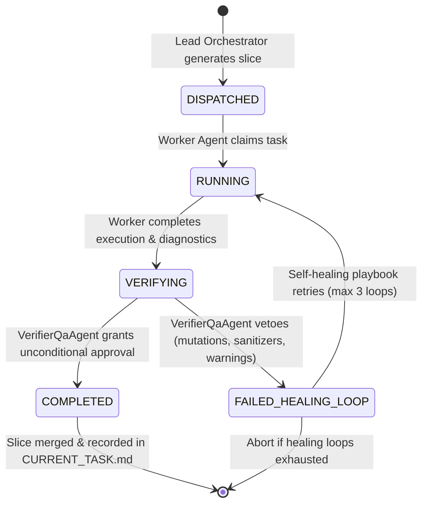

# `cpp-master` Agent Contracts & FSM Specification

## 1. Task + Playbook Contract State Machine

Every task slice in `cpp-master` is governed by an explicit Finite State Machine (FSM):



### Transition Validation Matrix

| Current State | Permitted Next States | Validation Rules |
| :--- | :--- | :--- |
| `DISPATCHED` | `RUNNING` | Worker must match task's `assigned_agent_id`. |
| `RUNNING` | `VERIFYING` | Execution log entries must be non-empty. |
| `VERIFYING` | `COMPLETED` | `VerifierQaAgent` must certify 0 warnings, clean sanitizers, CC <= 10, MSI >= 80%. |
| `VERIFYING` | `FAILED_HEALING_LOOP` | Veto triggers immediate execution of playbook self-healing steps. |
| `FAILED_HEALING_LOOP` | `RUNNING` | Permitted up to 3 retry attempts before escalation. |

---

## 2. JSON Schema for TaskPlaybookContract

```json
{
  "$schema": "https://json-schema.org/draft/2020-12/schema",
  "title": "TaskPlaybookContract",
  "type": "object",
  "required": [
    "contract_id",
    "task_id",
    "assigned_agent_id",
    "task_name",
    "state",
    "acceptance_criteria",
    "playbook"
  ],
  "properties": {
    "contract_id": { "type": "string" },
    "task_id": { "type": "string" },
    "assigned_agent_id": { "type": "string" },
    "task_name": { "type": "string" },
    "state": {
      "type": "string",
      "enum": ["DISPATCHED", "RUNNING", "VERIFYING", "COMPLETED", "FAILED_HEALING_LOOP"]
    },
    "acceptance_criteria": {
      "type": "array",
      "items": { "type": "string" }
    },
    "playbook": {
      "type": "object",
      "required": ["verification_command", "expected_failure_modes", "corrective_actions"],
      "properties": {
        "verification_command": { "type": "string" },
        "expected_failure_modes": {
          "type": "array",
          "items": { "type": "string" }
        },
        "corrective_actions": {
          "type": "array",
          "items": { "type": "string" }
        }
      }
    },
    "state_history": {
      "type": "array",
      "items": { "type": "string" }
    }
  }
}
```

---

## 3. Worker Specialization Routing Rules

The `TaskDecomposer` routes slices to domain specialists using keyword and semantic markers:

1. **`modern-cpp-architect`:** Keywords `concept`, `requires`, `range`, `constexpr`, `consteval`, `expected`, `optional`, `variant`, `monad`.
2. **`perf-hardware-optimizer`:** Keywords `cache`, `align`, `simd`, `vectorize`, `branch`, `likely`, `unlikely`, `soa`, `aos`, `zero-alloc`.
3. **`systems-concurrency-engineer`:** Keywords `thread`, `atomic`, `lockfree`, `memory_order`, `coroutine`, `jthread`, `mutex`, `cmake`.
4. **`security-safety-auditor`:** Keywords `security`, `safety`, `bounds`, `span`, `overflow`, `crypto`, `constant-time`, `cert`, `cwe`.
5. **`verifier-qa`:** Unconditional adversarial gate invoked at the conclusion of all worker executions.
