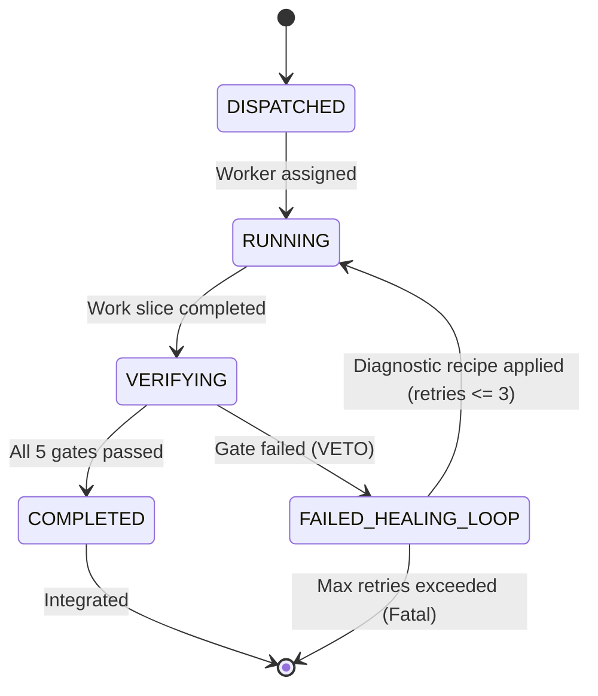

# Agent Execution Contracts & Finite State Machine Specification

## 1. TaskPlaybookContract Schema

Every task delegated to any worker must strictly serialize and adhere to a deterministic JSON contract validated at runtime by Zod:

```json
{
  "task_id": "SLICE-001-TOKEN-BUCKET",
  "assigned_agent": "runtime-optimizer",
  "scope": {
    "files_target": ["src/limiter/TokenBucket.ts"],
    "interfaces": ["RateLimiter", "LimiterOptions"]
  },
  "functional_invariants": [
    "Accepts AbortSignal and aborts immediately when signal.aborted is true",
    "Zero floating point drift in token refill rate calculations",
    "Clean timer disposal preventing Node.js process hang on exit"
  ],
  "playbook": {
    "verification_commands": [
      "pnpm exec vitest run src/limiter/TokenBucket.test.ts",
      "pnpm exec tsc --noEmit",
      "pnpm exec stryker run --mutate src/limiter/TokenBucket.ts"
    ],
    "known_failure_modes": [
      {
        "pattern": "UnhandledPromiseRejection: AbortError",
        "diagnostic_recipe": "Catch and wrap AbortError or ensure caller handles cancellation gracefully."
      },
      {
        "pattern": "Mutation survived: BlockStatement",
        "diagnostic_recipe": "Add property-based test with fast-check verifying refill boundary when time elapsed is 0."
      }
    ]
  }
}
```

### TypeScript Types
```typescript
declare const TaskIdBrand: unique symbol;
export type TaskId = string & { readonly [TaskIdBrand]: true };

export type AgentRole =
  | "type-architect"
  | "runtime-optimizer"
  | "api-engineer"
  | "security-auditor"
  | "verifier-qa";

export interface Scope {
  readonly files_target: readonly string[];
  readonly interfaces: readonly string[];
}

export interface KnownFailureMode {
  readonly pattern: string;
  readonly diagnostic_recipe: string;
}

export interface Playbook {
  readonly verification_commands: readonly string[];
  readonly known_failure_modes: readonly KnownFailureMode[];
}

export interface TaskPlaybookContract {
  readonly task_id: TaskId;
  readonly assigned_agent: AgentRole;
  readonly scope: Scope;
  readonly functional_invariants: readonly string[];
  readonly playbook: Playbook;
}
```

---

## 2. Finite State Machine (FSM) Lifecycle



### Transition Validation Rules
| From State | To State | Allowed | Invariant / Condition |
| :--- | :--- | :---: | :--- |
| `DISPATCHED` | `RUNNING` | Yes | Task contract deserialized and validated by Zod schema |
| `RUNNING` | `VERIFYING` | Yes | Worker execution finished without unhandled exceptions |
| `VERIFYING` | `COMPLETED` | Yes | All 5 gates (`compiler`, `deadCode`, `linter`, `mutation`, `property`) pass |
| `VERIFYING` | `FAILED_HEALING_LOOP` | Yes | At least one gate failed; `healRetries < maxRetries` |
| `FAILED_HEALING_LOOP` | `RUNNING` | Yes | Known failure mode diagnostic recipe dispatched |
| Any other | Any other | **No** | Throws `Invalid contract transition` |
