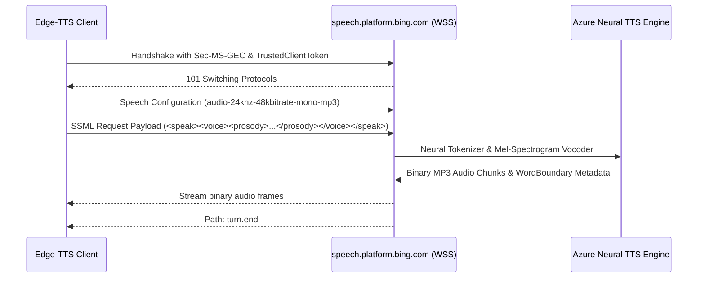

# Microsoft Edge-TTS Deep Engine Specification & Engineering Guide 🎙️⚡

**Microsoft Edge-TTS** is the industry standard for 100% free, zero-API-key neural voice synthesis. It leverages Microsoft's Azure Speech Service infrastructure (`speech.platform.bing.com`) using deep neural transformer voice models trained with multi-speaker mel-spectrogram conditioning and neural vocoders (HiFi-GAN).

---

## 1. Architectural Mechanics & WebSocket Protocol

Edge-TTS communicates directly over WebSocket connections to synthesize audio on demand:



### Key Technical Parameters:
- **Audio Output Format:** `audio-24khz-48kbitrate-mono-mp3` (default broadcast high-efficiency stream).
- **Sampling Rate:** 24,000 Hz (24 kHz) with 16-bit depth.
- **Latency:** ~250ms to first audio byte (real-time streaming capability).
- **Metadata Streams:** Emits `WordBoundary` and `SentenceBoundary` JSON events with 100-nanosecond tick offsets (`TICKS_PER_SECOND = 10,000,000`), allowing millisecond-accurate SRT/VTT subtitle generation.

---

## 2. Dynamic Prosody Boundaries (Safe Ranges)

While `edge-tts` accepts rate, pitch, and volume parameters, pushing values too far causes phase distortion, metallic phoneme clipping, or vocoder breakdown.

| Parameter | Recommended Safe Range | Hard Maximum Bounds | Acoustic Effect |
| :--- | :--- | :--- | :--- |
| **`rate` (Speed)** | `-12%` to `+15%` | `-35%` to `+40%` | Controls syllables-per-second. Beyond `+20%`, micro-pauses collapse. Below `-20%`, vowels unnaturally drag. |
| **`pitch` (Frequency)** | `-4Hz` to `+8Hz` | `-15Hz` to `+18Hz` | Shifts fundamental frequency $F_0$. $+5\text{Hz}$ simulates adrenaline/excitement; $-3\text{Hz}$ adds authority and gravitas. |
| **`volume` (Gain)** | `-5%` to `+6%` | `-20%` to `+10%` | Adjusts signal level prior to normalization. Keep near $0\%$ and master via EBU R128. |

---

## 3. Curated Master Voice Catalog

### A. Spanish Voices (Broadcast Tier)
| Voice Identifier | Gender | Tone & Timbre | Ideal Genre / Archetype | Regional Accent |
| :--- | :--- | :--- | :--- | :--- |
| `es-ES-AlvaroNeural` | Male | Deep baritone, authoritative, cinematic | Documentaries, history, dramatic essays | Spain (Castilian) |
| `es-MX-JorgeNeural` | Male | Warm, dynamic, energetic, punchy | Viral YouTube hooks, tech, storytelling | Mexico (Neutral Latin) |
| `es-AR-TomasNeural` | Male | Expressive, passionate, conversational | Sports commentary, narrative drama | Argentina |
| `es-CO-GonzaloNeural` | Male | Clear, formal, articulate, crisp | Corporate, tutorials, news reporting | Colombia |
| `es-MX-DaliaNeural` | Female | Engaging, empathetic, melodious | Vlogs, emotional stories, educational | Mexico (Neutral Latin) |
| `es-ES-ElviraNeural` | Female | Mature, sophisticated, broadcast news | Serious journalism, high-end narration | Spain (Castilian) |

### B. English Voices (Broadcast Tier)
| Voice Identifier | Gender | Tone & Timbre | Ideal Genre / Archetype | Regional Accent |
| :--- | :--- | :--- | :--- | :--- |
| `en-US-ChristopherNeural`| Male | Authoritative, gravitas, deep cinematic | Sci-Fi, movie trailers, crime stories | US Neutral |
| `en-US-GuyNeural` | Male | Conversational, friendly, articulate | Tech essays, tutorials, explainers | US Casual |
| `en-US-BrianNeural` | Male | Crisp, confident, engaging broadcast | News, corporate documentaries | US Commercial |
| `en-GB-RyanNeural` | Male | Sophisticated, BBC-style documentary | Historical analysis, luxury branding | UK British |
| `en-US-AriaNeural` | Female | Expressive, warm, narrative clarity | General storytelling, audiobooks | US Neutral |
| `en-US-JennyNeural` | Female | Upbeat, modern, clear, accessible | Marketing, tutorials, product demos | US Modern |

---

## 4. Multi-Beat Scene Audio Mastering Pipeline

Professional narration requires stitching distinct emotional scenes with acoustic silence padding and standard broadcast loudness normalization.

```
Scene 1 (Hook: +12% rate)      ──► [Audio Stem 1] ──┐
Scene 2 (Context: +0% rate)     ──► [Audio Stem 2] ──┼─► [Crossfade & 150ms Padding] ─► [EBU R128 Filter] ─► Master (-14 LUFS)
Scene 3 (Suspense: -8% rate)   ──► [Audio Stem 3] ──┘
```

### The Post-Processing Chain (FFmpeg):
1. **Silence Padding:** Insert $100\text{ms}$ silence lead-in and $250\text{ms}$ lead-out between scenes to prevent unnatural abrupt cuts.
2. **EBU R128 Loudness Normalization:**
   - Target Integrated Loudness: `-14.0 LUFS` (YouTube / Podcast standard)
   - True Peak: `-1.5 dBTP`
   - Loudness Range (LRA): `7.0 LU`
3. **FFmpeg Command Template:**
   ```bash
   ffmpeg -i combined_raw.mp3 \
     -af "loudnorm=I=-14.0:TP=-1.5:LRA=7.0:print_format=json" \
     -c:a libmp3lame -b:a 192k \
     mastered_voiceover.mp3
   ```

---

## 5. DRM Anti-Abuse Token & Network Resiliency

Microsoft requires dynamic token validation to prevent scraping:
- **`Sec-MS-GEC` Token:** Generated via SHA-256 hash of current Windows File Time (ticks since Jan 1, 1601 UTC) rounded down to 5 minutes, concatenated with `TRUSTED_CLIENT_TOKEN` (`6A5AA1D4EAFF4E9FB37E23D68491D6F4`).
- **Clock Skew Error (`403 Forbidden`):** If the client system clock deviates by more than 5 minutes from the Microsoft Edge gateway cluster, the handshake is rejected.
- **Regional IP Restrictions:** Certain cloud data center IP ranges or regions are blocked. In cloud execution environments (such as Kaggle, AWS, or GCP US-East), the connection is unblocked and executes with high throughput. When running locally behind restrictive gateways, supply an upstream HTTPS/SOCKS5 proxy via the `--proxy` argument in `edge_tts`.
