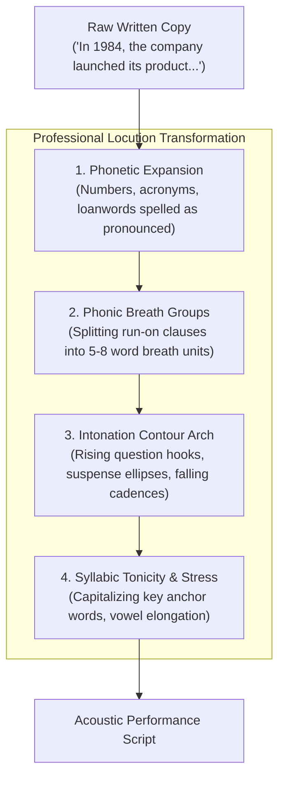
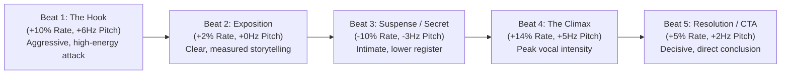

# Master Guide to Professional Locution, Diction & Cadence for Neural TTS 🎙️

Human broadcast announcers, documentary narrators, and voice actors do not speak text the way it is written on paper. Neural speech synthesis models (transformers trained on phonetic alignments and mel-spectrograms) sound robotic and monotonous primarily because written text lacks the physiological, musical, and rhetorical markers that human vocal cords produce naturally.

This guide provides the foundational phonetic, prosodic, and syntactic laws required to make neural TTS models—especially **Microsoft Edge-TTS**, **Kokoro**, **ElevenLabs**, and **Gemini 3.8 Flash TTS**—sound authentic, expressive, and human.

---

## 1. The Anatomy of Human Speech (Orality vs. Writing)

Written language is optimized for visual scanning and semantic compactness; spoken language is constrained by **lung capacity, diaphragmatic pressure, and auditory retention**.



### The 4 Pillars of Locution:
1. **Phonic Group (*Grupo Fónico*):** The maximum string of words uttered between two natural breaths (average 5 to 8 words). Any clause exceeding 12 words forces the TTS model into flat, breathless pacing.
2. **Inflection Arches (*Curvas de Entonación*):**
   - **Anticadence (Rising / Hook):** Pitch rises at the end of introductory clauses or questions (`¿?`), creating anticipation.
   - **Suspension (Plateau):** Pitch remains level across parenthetical asides (`—` or `,`), signaling that the thought is incomplete.
   - **Cadence (Falling / Resolution):** Pitch drops decisively at a period (`.`), marking closure, authority, and finality.
3. **Emphatic Tonicity:** Human speakers increase amplitude, lower pitch slightly, and lengthen vowels on the 1–2 most informative words in a sentence.
4. **Articulatory Diction:** Clear separation between consonants, eliminating ambiguous homographs, and preventing awkward glottal stops or robotic elisions.

---

## 2. Text Normalization & Phonetic Disambiguation

Neural models stumble when encountering raw symbols, numbers, and ambiguous homographs. **All numerals, dates, units, and acronyms must be expanded phonetically before synthesis.**

### A. Numbers, Dates & Currencies
| Written Format | Why Neural TTS Fails | Mandatory Spoken Phonetization (Spanish / English) |
| :--- | :--- | :--- |
| `$1,500,000` | Reads "un millón quinientos mil pesos/dólares" inconsistently | *Spanish:* `un millón y medio de dólares`<br>*English:* `one point five million dollars` |
| `2026` | May read as "dos mil veintiséis" or "veinte veintiséis" | *Spanish:* `dos mil veintiséis`<br>*English (Year):* `twenty twenty-six`<br>*English (Quantity):* `two thousand and twenty-six` |
| `15 km/h` | May read "quince k-m barra h" | *Spanish:* `quince kilómetros por hora`<br>*English:* `fifteen kilometers per hour` |
| `3.5%` | Drops decimal inflection | *Spanish:* `tres coma cinco por ciento`<br>*English:* `three point five percent` |
| `1/4` | May pronounce "uno barra cuatro" | *Spanish:* `un cuarto`<br>*English:* `one quarter` |

### B. Acronyms & Abbreviations
- **Pronounceable Acronyms (*Acrónimos lecturables*):** Write as capitalized words if read phonetically (e.g., `NASA`, `OTAN`, `UNESCO`, `Unicef`).
- **Letter-by-Letter Acronyms (*Siglas deletreadas*):** Hyphenate or spell phonetically to prevent the model from pronouncing them as strange words:
  - *Spanish:* Write `F-B-I` or `Efe-Be-I`, `C-I-A` or `Se-I-A`, `U-E` (Unión Europea).
  - *English:* Write `F-B-I`, `C-I-A`, `D-N-A`, `N-F-T`.
- **Title Abbreviations:** Expand `Dr.` → `Doctor`, `EE.UU.` → `Estados Unidos`, `vs.` → `contra` or `versus`, `etc.` → `etcétera`.

### C. Foreign Words & Loanwords
Neural models apply the phonology of the selected voice. If an English loanword is pronounced in a Spanish voice (`es-MX-JorgeNeural`), native spelling may sound unintelligible:
- *Streaming:* `streaming` → write `estríming` or `transmisión en vivo`.
- *Smartphone:* `smartphone` → write `teléfono inteligente` or `esmart-fon`.
- *Software:* write `sóft-wer`.
- *Bitcoin:* write `bít-coin`.

---

## 3. Punctuation as Acoustic Programming Code

In modern neural TTS (specifically Edge-TTS and ElevenLabs), **punctuation is not grammatical—it is acoustic timing and pitch code.**

```
Symbol    Neural Acoustic Impact                          Optimal Duration
──────────────────────────────────────────────────────────────────────────
 .        Full pitch reset, cadence drop, hard stop       400ms – 550ms
 ,        Micro-pause, pitch suspension                   150ms – 250ms
 ...      Decaying pitch slope, suspense deceleration     350ms – 500ms
 —        Timbre drop, parenthetical aside cadence        200ms – 300ms
 :        Tension pause, resets acoustic ceiling          250ms – 350ms
 ;        Cadence semi-closure                            300ms – 400ms
 ¡ !      Rising energy, pitch spike, immediate attack    Dynamic
 ¿ ?      Rising pitch curve, interrogative anticipation  Dynamic
```

### The Inverted Mark Law (Hispanic Voices)
In Spanish models (`es-MX`, `es-ES`, `es-AR`, `es-CO`):
- The model uses the opening `¡` and `¿` to condition the neural attention vector **at the start of the clause**.
- If you write `Increíble lo que pasó!`, the voice sounds flat until the final word.
- If you write `¡Increíble lo que pasó!`, the voice attacks with energy and elevated pitch from the very first syllable.

---

## 4. The 5-Beat Locution Cadence Formula

Every high-retention narration follows a dynamic 5-beat emotional trajectory. Never synthesize an entire 60-second video with a single flat prosody setting:



1. **The Cold Hook (First 3–5 seconds):**
   - High pitch attack, punchy phrasing, 5-word breath chunks.
   - *Example:* `¡Nadie lo vio venir! El secreto mejor guardado de la misión... acaba de salir a la luz.`
2. **Context & Exposition (Storytelling):**
   - Steady rhythm, neutral volume, clear syllabic separation.
3. **The Pivot / Mystery:**
   - Decelerate speed (`rate="-8%"`), lower pitch (`pitch="-3Hz"`), utilize ellipses (`...`).
   - *Example:* `Pero detrás de los números... había una verdad que nadie se atrevía a pronunciar.`
4. **The Dramatic Climax:**
   - Accelerated pace, volume boost, emphasized capitalized words (`¡TODO!`, `¡NUNCA!`).
5. **The Landing / Call to Action:**
   - Authoritative cadence, steady finality, direct conversational eye-level.

---

## 5. Locution Quality Scorecard (Self-Audit Gate)

Before rendering audio, audit your script against this 7-point checklist:

- [ ] **Breath Test:** Is any sentence longer than 12 words without a comma, dash, or period? *(If yes, split it).*
- [ ] **Numeral Expansion:** Are all digits, years, currencies, and percentages fully written out as spoken words?
- [ ] **Inverted Marks:** Do all Spanish exclamation and question sentences begin with `¡` and `¿`?
- [ ] **Suspense Anchors:** Are key revelations preceded by an ellipsis (`...`) or colon (`:`)?
- [ ] **Emphasis Allocation:** Are at most 1–2 critical keywords per paragraph capitalized for acoustic stress?
- [ ] **Foreign Term Check:** Are foreign words phonetically transcribed or replaced with native terms?
- [ ] **Dynamic Prosody:** Is the script segmented into distinct emotional beats with tuned rate/pitch settings?
