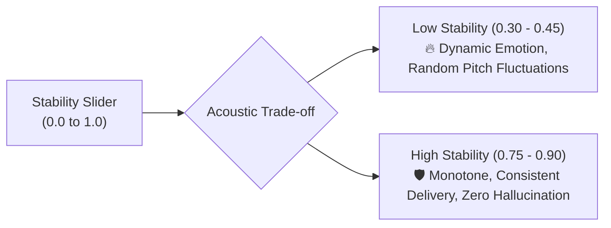

# ElevenLabs v2 & v3: Expressive Production Voice Guide 🎙️💎

ElevenLabs provides high-expressivity commercial neural voice cloning and generative speech. Mastering ElevenLabs requires understanding the mathematical trade-offs between stability, clarity, and style exaggeration.

---

## 1. Engine Model Matrix

| Model Tier | Latency | Expressivity / Emotion | Best Use Case |
| :--- | :--- | :--- | :--- |
| **Eleven Multilingual v2** | ~400ms | High (nuanced accents, multi-language stability) | High-end audiobooks, long-form documentary films |
| **Eleven Turbo v2.5** | ~150ms | Very High (faster token generation) | Real-time agents, conversational streaming, short-form content |
| **Eleven v3 (Generative)** | ~300ms | Maximum (dynamic emotional range, audio prompting) | Character dialogue, cinematic trailers, dramatic voice acting |

---

## 2. Voice Settings Calibration Formula



### The 4 Core Parameter Sliders:
1. **Stability (`0.0` – `1.0`):**
   - **`0.35 – 0.48` (Cinematic / Dramatic):** High emotional variance, expressive whispers, gasps, and intensity shifts.
   - **`0.70 – 0.82` (Corporate / Explainer):** Clean, steady, predictable broadcast delivery.
   - *Warning:* Setting stability below `0.30` can introduce vocal stuttering or unnatural breath artifacts.
2. **Clarity + Similarity Enhancement (`0.0` – `1.0`):**
   - Recommended: `0.75 – 0.85`. High fidelity to original voice timbre without boosting high-frequency background hiss.
3. **Style Exaggeration (`0.0` – `1.0`):**
   - Recommended: `0.05 – 0.15`. Amplifies the distinct stylistic identity of the speaker.
   - *Warning:* Values above `0.25` often introduce instability and robotic distortion.
4. **Speaker Boost (`boolean`):**
   - Set to `True` for maximum voice presence and forward projection in mixdown.

---

## 3. Acoustic Script Prompting & Audio Directives

In ElevenLabs v3 and Multilingual v2, conversational inflection is shaped by text markers:

- **Audio Cues in Brackets:** Insert momentary emotional cues directly into text:
  `"[whispers] Keep your voice down... [heavy sigh] They are listening to every transmission."`
- **Punctuation Pacing:**
  - Em-dashes (`—`): Creates a sudden pause with intonation drop.
  - Ellipses (`...`): Lengthens the preceding vowel and slows tempo.
  - Exclamation (`!`): Increases volume and fundamental frequency $F_0$.

---

## 4. Production API Payload

```python
import os
from elevenlabs.client import ElevenLabs

client = ElevenLabs(api_key=os.getenv("ELEVENLABS_API_KEY"))

audio_stream = client.text_to_speech.convert(
    voice_id="pNInz6obpgDQGcFmaJgB", # Adam (Cinematic Baritone)
    model_id="eleven_multilingual_v2",
    text="Deep beneath the Martian crust, a silent relic stood undisturbed for millennia. Until today.",
    voice_settings={
        "stability": 0.42,
        "similarity_boost": 0.80,
        "style": 0.10,
        "use_speaker_boost": True
    }
)

with open("elevenlabs_master.mp3", "wb") as f:
    for chunk in audio_stream:
        f.write(chunk)
```
