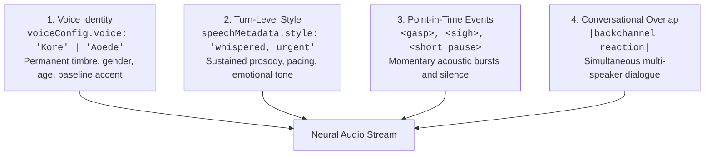

# Google Gemini 3.8 Flash TTS & Multimodal Voice Guide 🎙️🤖

Google Cloud Gemini Enterprise Agent Platform provides the **Gemini 3.8 Flash TTS** engine, designed for sub-second conversational agents and emotionally dynamic voice synthesis.

---

## 1. Architectural Scope Partitioning

The defining rule of Gemini 3.8 TTS is strict separation of concerns:



### Golden Rules:
1. **Never Put Age, Gender, or Persona Descriptions in `style`:** Doing so induces vocal timbre drift between turns. Define the persona once via `voiceConfig.voice`.
2. **Inline Tags in Angle Brackets (`<...>`):** Insert standard human non-speech vocalizations directly into transcript text.
3. **Always Keep Tags in English:** Even if the dialogue is in Spanish, German, or Japanese, the inline tags must remain in English (e.g. `<sigh>`, `<gasp>`).
4. **Stress via Capitalization:** Use uppercase words for acoustic emphasis (`"This is VITAL"`).

---

## 2. Standard Inline Vocal Event Library

| Category | Recommended Inline Tags |
| :--- | :--- |
| **Breathing & Pauses** | `<breath>`, `<heavy breath>`, `<exhales>`, `<pant>`, `<short pause>`, `<long pause>` |
| **Emotional Bursts** | `<gasp>`, `<sigh>`, `<sob>`, `<cry>`, `<groan>`, `<grunt>`, `<grr>`, `<whimper>`, `<argh>` |
| **Disfluencies & Laughter** | `<chuckle>`, `<laughter>`, `<snicker>`, `<giggle>`, `<cackle>`, `<yawn>`, `<cough>`, `<throat-clearing>`, `<tsk>`, `<phew>` |

---

## 3. Backchannels & Overlapping Dialogue

To simulate realistic human conversation without creating separate micro-turns, wrap listener reactions in pipe characters (`|reaction|`) inside the primary speaker's sentence:

```text
Turn 1 (Dr. Vance): "So the telemetry confirms orbital decay |oh no| and we have under five minutes."
Turn 2 (Commander): "Under five minutes? |stay calm| Initiate the reactor purge immediately!"
```

---

## 4. Production API Request Payload

```json
{
  "contents": [
    {
      "role": "user",
      "parts": [
        {
          "text": "Wait... <short pause> did you hear that? <gasp> Someone is outside the airlock. |stay back| We must seal door four RIGHT NOW! <heavy breath>",
          "speechMetadata": {
            "style": "whispered, urgent, speaking rapidly"
          }
        }
      ]
    }
  ],
  "generationConfig": {
    "responseModalities": ["AUDIO"],
    "speechConfig": {
      "voiceConfig": {
        "voice": "Kore"
      }
    }
  }
}
```
